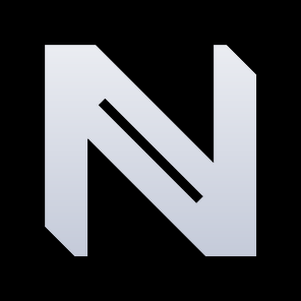

<p align="center">
  
</p>

<h1 align="center">Nexify</h1>

<p align="center">Turn websites and web projects into standalone Android APKs, right on your phone.</p>

Nexify is developed by **AHR** ([@anikhasanjihad22](https://github.com/anikhasanjihad22)).

## Features

- WebView and GeckoView engines, userscripts and extension modules, Node/PHP/Python/Go runtimes, and an on-device APK builder.
- **Block screenshots & screen recording** - a per-app switch under the WebView settings. When on, generated apps show a black frame to screenshots and screen recorders, and the recent-apps preview is hidden.
- **Ask before exit** - a back button behavior. On the first page, Back opens an *Exit / Stay* dialog.

## Building

Push to GitHub and run the **Build Nexify APK** workflow (Actions tab). The APKs show up as the `Nexify-APK` artifact. Pushing a tag such as `v1.0.0` also publishes them as a release.

Locally or in a Codespace:

```bash
bash scripts/build_nexify.sh
```

## License

[MIT](LICENSE) with an attribution requirement: anyone using Nexify must credit **AHR** as the developer. See [NOTICE](NOTICE).
